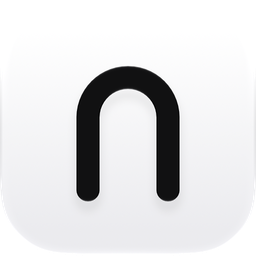
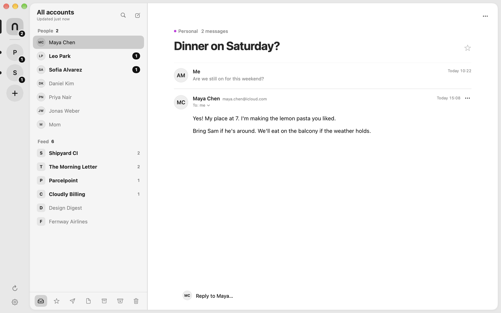
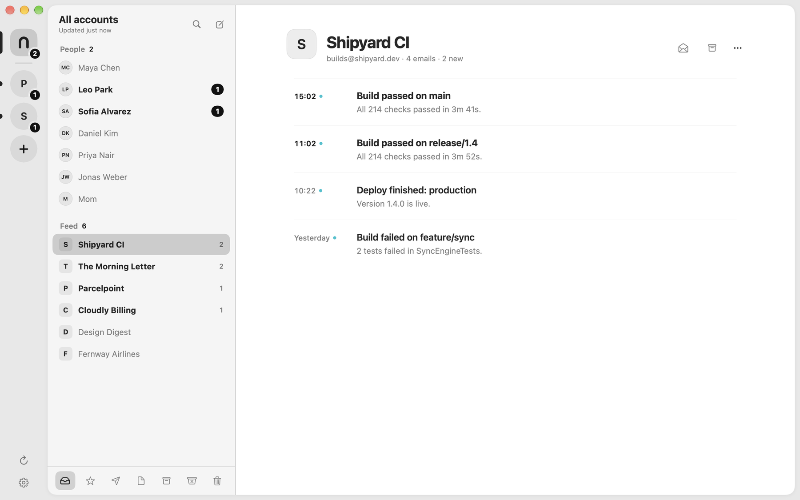
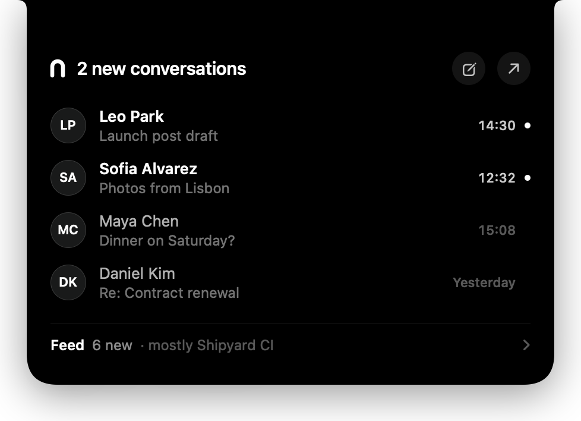
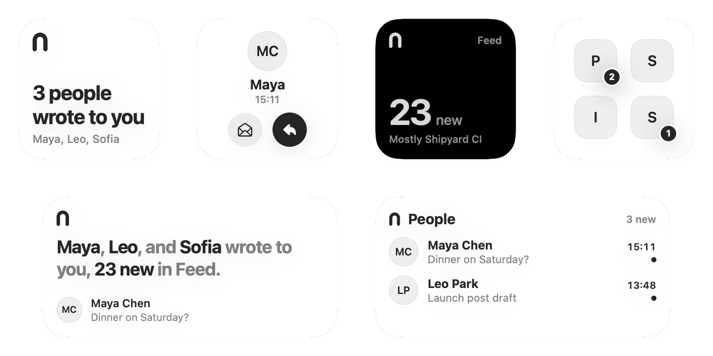

<p align="center">
  <picture>
    <source media="(prefers-color-scheme: dark)" srcset="docs/images/icon-dark.png">
    
  </picture>
</p>

<h1 align="center">Nook</h1>

<p align="center">
  <b>A calm, people-first mail client for Mac.</b><br>
  Native, free, and private: your mail never leaves your Mac.
</p>

<p align="center">
  <a href="https://github.com/devsemih/nook/releases/latest"><b>Download for macOS</b></a>
  &nbsp;·&nbsp;
  <a href="#connect-your-accounts">Connect your accounts</a>
  &nbsp;·&nbsp;
  <a href="#build-from-source">Build from source</a>
</p>

<p align="center">
  
  
  
</p>

<picture>
  <source media="(prefers-color-scheme: dark)" srcset="docs/images/people-dark.png">
  
</picture>

## Why Nook

Most inboxes treat a message from your friend the same as a shipping update, a newsletter and a build notification. The mail that matters gets buried.

Nook sorts your inbox by **who** wrote to you:

- **People.** Everyone who writes to you gets their own channel, right at the top. Replies stay together as one conversation.
- **Feed.** Newsletters, receipts, notifications and bills are grouped by sender and wait quietly underneath. Read them when you want to, or archive a whole sender in one click.
- **Calm by default.** Only mail from people shows up in your notch, your widgets and your notifications. The Feed never interrupts you.

## Features

### People and Feed

Every sender in the Feed is a single row, no matter how many messages they send. Open one and read them like a timeline. If Nook puts someone in the wrong place, move them between People and Feed and it remembers.

<picture>
  <source media="(prefers-color-scheme: dark)" srcset="docs/images/feed-dark.png">
  
</picture>

### Your notch, alive

On Macs with a notch, Nook lives right inside it. At rest it shows how many people are waiting for you. When someone writes, it opens for a moment to show who it is. Hover to see your people, your Feed or your latest mail, then click a row to jump straight to it.

Sign-in codes show up there too, with a Copy button, so you never have to open the email. And it's yours to shape: choose what it shows at rest, whether new mail opens it, how long it stays, and whether it opens on hover or on click.

<p align="center">
  
</p>

### Widgets

Six desktop widgets in the same black and white style: who wrote to you, the latest person with a one-click reply, a one-sentence briefing, your recent conversations, the Feed and your accounts.

<picture>
  <source media="(prefers-color-scheme: dark)" srcset="docs/images/widgets-dark.png">
  
</picture>

### And the rest

- **All your accounts in one place.** iCloud and as many Gmail accounts as you like, unified or one at a time.
- **Built for the keyboard.** Quick switcher, shortcuts for everything, Enter to open, E to archive.
- **Quick replies** right under a conversation, with a full composer when you need it.
- **Unsubscribe in one click.** Nook uses the sender's own unsubscribe link, quietly in the background when the sender supports it.
- **Themes.** Black and white by default, with Paper and Ink variants and a handful of colourful ones.
- **Blocks trackers.** Remote images stay off until you allow them.

## How Nook compares

|  | Nook | HEY | Spark | Apple Mail |
| --- | :-: | :-: | :-: | :-: |
| Free | ✓ | – | Free tier | ✓ |
| Keeps your iCloud and Gmail address | ✓ | – | ✓ | ✓ |
| Separates people from bulk mail | ✓ | ✓ | ✓ | Categories |
| Mail goes only between your Mac and your provider | ✓ | – | – | ✓ |
| Open source | ✓ | – | – | – |

<sub>Based on each product's public documentation as of November 2026. Something out of date? Please open an issue.</sub>

## Install

1. Download the latest **Nook.dmg** from [Releases](https://github.com/devsemih/nook/releases/latest).
2. Open it and drag **Nook** into **Applications**.
3. Open Nook. It's signed and notarized by Apple, so it opens like any other app.

Nook needs **macOS 26 Tahoe** or later.

## Connect your accounts

Nook talks to your mail provider directly over IMAP and SMTP using an **app-specific password**. You don't need to create any developer project or give Nook your real password. The app walks you through each step.

### iCloud

1. Go to [account.apple.com](https://account.apple.com) › **Sign-In and Security** › **App-Specific Passwords** and create one called "Nook". Two-factor authentication must be on.
2. In Nook, choose **Add account** › **iCloud** and paste your iCloud address and the password (`xxxx-xxxx-xxxx-xxxx`).

### Gmail

1. Make sure [2-Step Verification](https://myaccount.google.com/signinoptions/twosv) is turned on.
2. Create an [app password](https://myaccount.google.com/apppasswords) called "Nook". Google shows a 16-letter password.
3. In Nook, choose **Add account** › **Gmail** and paste your Gmail address and the password.

## Privacy

- **No servers.** There is no Nook backend. Your Mac connects straight to iCloud or Gmail.
- **Local storage.** Mail is kept in a local database on your Mac. Passwords live in your Keychain.
- **No tracking.** No analytics, no telemetry, no accounts. Remote images in mail stay blocked until you allow them.

## Build from source

You'll need Xcode 26 and [XcodeGen](https://github.com/yonaskolb/XcodeGen).

```bash
brew install xcodegen
git clone https://github.com/devsemih/nook.git
cd nook
xcodegen generate
open Posta.xcodeproj
```

By default the project builds with **Sign to Run Locally**, so it runs without an Apple developer account. To sign with your own team, which keeps the Keychain from asking for access after every build and lets the widgets share data with the app, copy `Config/Signing.xcconfig.example` to `Config/Signing.xcconfig` and set your team ID.

Want to try it without connecting an account? Launch with sample data. Nothing is read from or written to your real mail database:

```bash
open build/Build/Products/Debug/Nook.app --args -NookDemo YES
```

Releases are built with `scripts/release.sh`, which archives, signs with Developer ID, notarizes and staples a `.dmg`.

> The Xcode project and Swift module are still called `Posta`, Nook's working title.

## Limitations

- macOS 26 or later only.
- iCloud and Gmail only for now. Other IMAP providers may work, but aren't tested.
- Gmail needs 2-Step Verification to create an app password.
- Sorting people from bulk mail is a heuristic. It's right most of the time, and you can move any sender with one click.

## Contributing

Issues and pull requests are welcome. If you're planning something bigger, open an issue first so we can talk it through.

## License

[MIT](LICENSE) © 2026 Odin Studio
